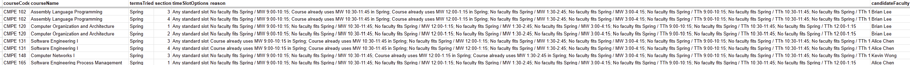

# Schedulr

> A constraint-based faculty scheduling tool that automatically assigns professors to courses and generates time slots based on preferences, availability, and eligibility.

## Group 7

| Name   | GitHub                                                 | Email                      |
| ------ | ------------------------------------------------------ | -------------------------- |
| Name 1 | [@nick-mama](https://github.com/nick-mama)             | nickjason.mamaoag@sjsu.edu |
| Name 2 | [@vancednguyen](https://github.com/vancednguyen)       | vance.nguyen@sjsu.edu      |
| Name 3 | [@YashSat21](https://github.com/YashSat21)             | yashas.satheesh@sjsu.edu   |
| Name 4 | [@michaelnathykim](https://github.com/michaelnathykim) | michael.n.kim@sjsu.edu     |

**Advisor:** Professor Rojas

---

## Project Description

Schedulr is a faculty course planning system that automates the process of assigning professors to courses and generating valid schedules. It uses instructor preferences, availability, prior teaching history, and institutional constraints to produce a feasible schedule.

## Problem Statement

Departments currently rely on manual spreadsheets to plan CMPE and SE course offerings, making demand forecasting and multi-term coordination inefficient and error-prone. It’s difficult to balance prerequisites, outside course schedules, faculty preferences, and workload constraints without creating conflicts or mismatched capacity.

## Proof of Concept Scope

This PoC demonstrates:

- End-to-end scheduling pipeline:
  - Google Form → Data cleaning → Faculty & eligibility generation → Schedule output
- Automatic assignment of:
  - Professors to courses
  - Time slots to course sections
- Constraint handling:
  - Instructor availability
  - Maximum teaching load
  - Course eligibility
  - Time conflicts

**Not included yet:**

- UI/dashboard
- Optimization beyond greedy assignment
- Room assignment

## Live PoC

Google Sheet (Scheduler): https://docs.google.com/spreadsheets/d/1lojaKJ_upQNaAoNeLLrqR7sFTTfOgHD1zpiIz_9MTRs/edit?usp=sharing

Google Form (Input): https://forms.gle/BSXZEJVfRYdtAs1t9

Use the form to submit sample responses, then run the scheduler from the Sheet menu (see **Running the PoC** section).

## Prerequisites

- Google account
- Google Sheets
- Node.js (for clasp)
- clasp CLI

Install clasp:

```bash
npm install -g @google/clasp
clasp login
```

## Installation

```bash
git clone https://github.com/SJSU-CMPE-195/group-project-team-67.git
cd schedulr_apps_script
clasp pull
```

## Apps Script Setup

This project uses `clasp` to sync local code with Google Apps Script.

You must create a `.clasp.json` file in the **root directory** of the project.

### Quick Setup:

1. Run:

**Mac/Linux:**

```bash
cp .clasp.json.txt .clasp.json
```

**Windows (PowerShell):**

```bash
Copy-Item .clasp.json.txt .clasp.json
```

2. Open the new `.clasp.json` file

3. Replace the placeholder with the Apps Script ID

To get the script ID:

- Open the Google Sheet
- Go to **Extensions -> Apps Script**
- Click **Project Settings**
- Copy the **Script ID**

Example `.clasp.json` file:

```json
{
  "scriptId": "YOUR_SCRIPT_ID_HERE",
  "rootDir": "schedulr_apps_script"
}
```

## Running the PoC

1. Open the connected Google Sheet
2. Submit sample responses through the Google Form
3. In the Sheet menu, click **Schedulr** and run:

- Clean preferences
- Build faculty sheet
- Build eligibility sheet
- Generate schedule

4. View outputs in:

- ScheduleOutput
- Conflicts
- Course_Overview

## Demo

### Schedule Output


Shows assigned professors and generated time slots based on preferences and constraints.

### Conflicts



Shows courses that could not be assigned due to constraints such as time conflicts, limited availability, or maximum load limits. Candidate faculty are listed to show why no valid assignment could be made within the current constraints.

## Tech Stack

| Category  | Technology             |
| --------- | ---------------------- |
| Backend   | Google Apps Script     |
| Data      | Google Sheets          |
| Input     | Google Forms           |
| Scripting | JavaScript             |
| Scraping  | Python (BeautifulSoup) |
| Tools     | Git, clasp             |

## What's Next (195B)

- Improve scheduling algorithm (constraint optimization)
- Add UI dashboard
- Integrate real historical data
- Add room assignment
- Improve preference weighting system

## Project Structure

```
.
├── schedulr_apps_script/ # Apps Script scheduler
├── sjsu_data_scraper/ # Python scraper
├── docs/ # Screenshots
├── README.md
```

## License

This project is licensed under the <FILL IN> License - see the [LICENSE](LICENSE) file for details.

---

_CMPE 195A/B - Senior Design Project | San Jose State University | Spring 2026_
