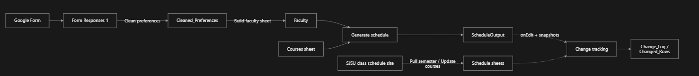
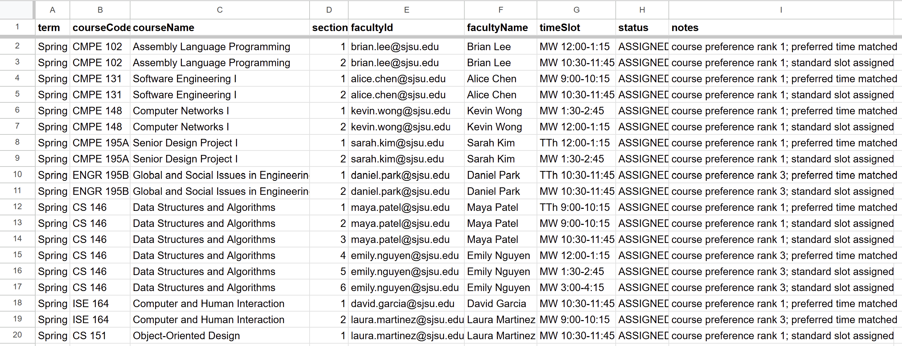
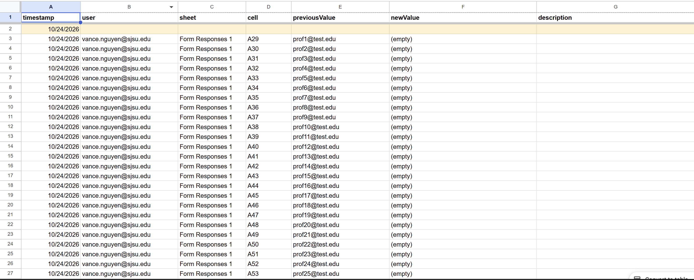

# Schedulr

> A constraint-based faculty scheduling tool that automatically assigns professors to courses and generates time slots based on preferences and availability.

## Team

| Name   | GitHub                                           | Email                      |
| ------ | ------------------------------------------------ | -------------------------- |
| Nick   | [@nick-mama](https://github.com/nick-mama)       | nickjason.mamaoag@sjsu.edu |
| Vance  | [@vancednguyen](https://github.com/vancednguyen) | vance.nguyen@sjsu.edu      |
| Yashas | [@YashSat21](https://github.com/YashSat21)       | yashas.satheesh@sjsu.edu   |

**Advisor:** Professor Rojas

---

## Project Description

Departments plan CMPE and SE course offerings in manual spreadsheets, which makes it hard to balance faculty preferences, availability, and workload without creating conflicts. Schedulr runs inside Google Sheets: professors submit preferences through a Google Form, Apps Script scripts clean the responses, assign professors to course sections and time slots, and record every edit to the schedule so reviewers can see, undo, or accept changes.

## Prototype Scope

**_Works end to end now_**

- Pipeline: Google Form → Clean preferences → Build faculty sheet → Generate schedule → ScheduleOutput sheet
- Greedy assignment of professors to course sections and time slots, constrained by instructor availability, maximum teaching load, and time conflicts (a professor cannot hold two sections in the same term and slot)
- Change tracking on schedule sheets
- Course data tools (Courses menu): pull SJSU semester sections, update the schedule sheet from the SJSU Fall 2026 schedule, create a blank schedule from a pulled semester, fill a schedule from form responses, and compare room sizes against a Rooms sheet

**_Incomplete / left for the Expo_**

- Scheduling is greedy, with no optimization beyond that
- Room planning is not integrated into schedule generation
- No automated test suite yet

## System Architecture



All logic lives in Google Apps Script bound to one Google Sheet. Change tracking uses onEdit plus hidden `_snap_<SheetName>` mirror sheets to recover old values on bulk edits. Code is synced to Apps Script with clasp.

## Prerequisites

- Google account with access to the Schedulr Google Sheet and Form
- Node.js 20 or newer (the deploy workflow uses Node 20) and npm
- clasp CLI
- Git

## Installation

1. Clone the repository:

```bash
git clone https://github.com/SJSU-CMPE-195/group-project-team-67.git
cd group-project-team-67
```

2. Install dependencies:

```bash
npm ci
```

3. Install clasp and log in:

```bash
npm install -g @google/clasp
clasp login
```

4. Create your clasp config from the template:

Mac/Linux

```bash
cp .clasp.json.txt .clasp.json
```

Windows (PowerShell)

```powershell
Copy-Item .clasp.json.txt .clasp.json
```

5. Open .clasp.json and replace the placeholder with your Apps Script Script ID (in the Sheet: Extensions → Apps Script → Project Settings → Script ID):

```json
{
  "scriptId": "YOUR_SCRIPT_ID_HERE",
  "rootDir": "schedulr_apps_script"
}
```

6. Push the code to Apps Script:

```bash
clasp push
```

## Running the Prototype

Demo Sheet: https://docs.google.com/spreadsheets/d/1lojaKJ_upQNaAoNeLLrqR7sFTTfOgHD1zpiIz_9MTRs/edit?usp=sharing

Demo Form: https://forms.gle/BSXZEJVfRYdtAs1t9

1. Submit sample responses through the Google Form. The sheet also needs a Courses sheet.
2. In the Sheet, open the Schedulr menu and run in order:

   | Step | Menu item           | What it does                                 |
   | ---- | ------------------- | -------------------------------------------- |
   | 1    | Clean preferences   | Parses and normalizes raw form responses     |
   | 2    | Build faculty sheet | Extracts faculty availability and max load   |
   | 3    | Generate schedule   | Assigns professors to courses and time slots |

3. Read the result in the ScheduleOutput sheet.
4. Edit any schedule cell, then use the change-tracking items in the Schedulr menu:

| Menu item           | What it does                                           |
| ------------------- | ------------------------------------------------------ |
| View Change Log     | Opens Change_Log, grouped by day, newest first         |
| View Changed Rows   | Shows the full row for every row with a tracked change |
| Jump to Next Change | Moves to the next highlighted cell                     |
| Undo Changes        | Steps a changed cell back one edit at a time           |
| Accept All Changes  | Clears highlights and notes, keeps current values      |
| Clear Change Log    | Wipes Change_Log rows (manual only)                    |

5. The Courses menu contains: Update Courses, Comparing Room Size (Current Page), Create blank schedule, Pull Semester Schedule, and Fill in Responses.

## Testing

Automated tests are not currently included. To test manually:

1. Submit sample responses through the Google Form.
2. Run Clean preferences.
3. Run Build faculty sheet.
4. Run Generate schedule.
5. Confirm that ScheduleOutput contains assigned professors and time slots.
6. Confirm no professor is assigned to two sections in the same term and time slot.
7. Edit a schedule cell and confirm the change appears in Change_Log.
8. Test Undo Changes and Accept All Changes.

## Demo

Demo Video: <(https://drive.google.com/file/d/1uY2hpvLbm7qXBEp0BpeCVKY3JAoeizrZ/view?usp=sharing)>

### Schedule Output



Assigned professors and time slots generated from preferences and constraints.

### Change Log



Keeps track of changes made in different sheets.

## Technical Stack

| Category  | Technology         |
| --------- | ------------------ |
| Backend   | Google Apps Script |
| Data      | Google Sheets      |
| Input     | Google Forms       |
| Scripting | JavaScript         |
| Tools     | Git, clasp         |

## What's Next

Before the Project Expo on December 11:

- Integrate room data into the broader schedule
- Add automated tests and run them in CI
- Write a user guide for staff who will use the Sheet
- Improve the assignment algorithm beyond greedy
- Confirm with the advisor how the department schedules today and adjust the model

## Project Structure

```
.
├── schedulr_apps_script/   # Apps Script source
│   ├── main.gs             # Menu, cleaning, faculty, scheduling, change log
│   ├── snapshotDiff.gs     # Bulk-edit tracking via hidden snapshot sheets
│   ├── courses.gs          # Update schedule from SJSU site
│   ├── pull_semester.gs    # Pull SJSU semester sections
│   ├── blank_schedule.gs   # Create blank schedule from a pulled semester
│   ├── fill_in.gs          # Fill schedule from form responses
│   ├── compare_rooms.gs    # Compare section sizes with room capacities
│   └── appsscript.json     # Manifest
├── docs/screenshots/       # Demo screenshots
├── Visualization/          # Design visuals
├── .github/workflows/      # CI and deploy workflows
├── tests/                  # Tests (in development)
├── .clasp.json.txt         # Clasp config template (copy to .clasp.json)
└── README.md
```

## License

This project is licensed under the <FILL IN> License - see the [LICENSE](LICENSE) file for details.

---

_CMPE 195A/B - Senior Design Project | San Jose State University | Fall 2026_
